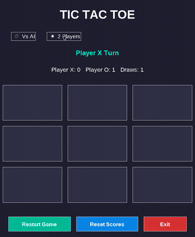
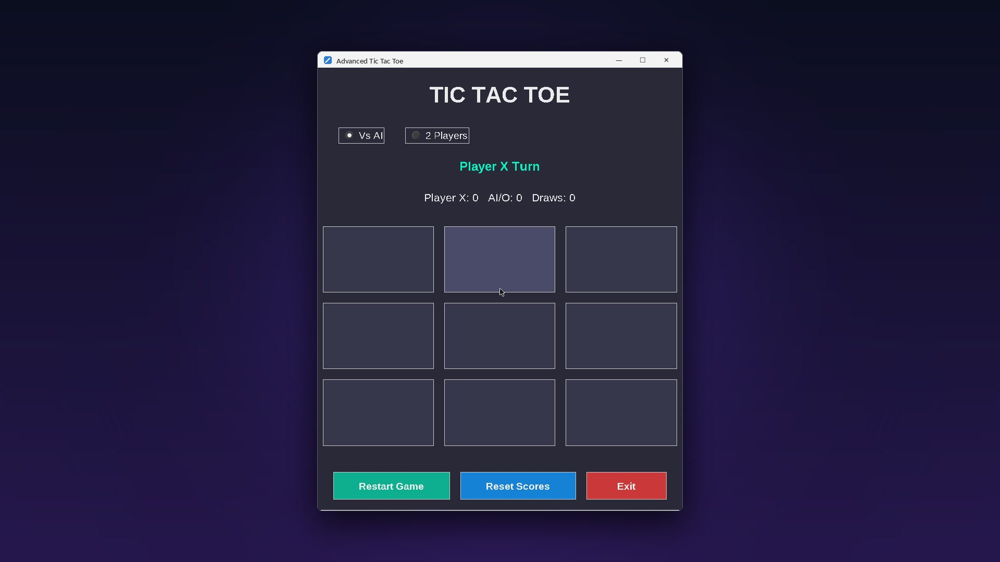
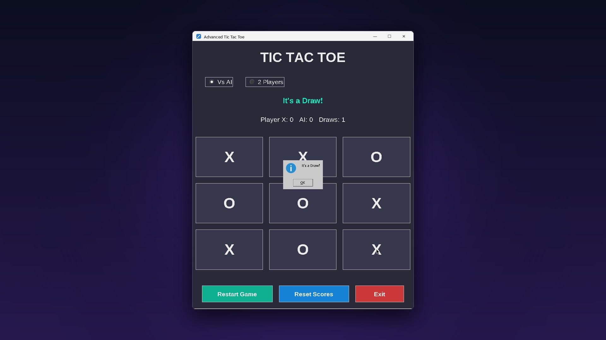
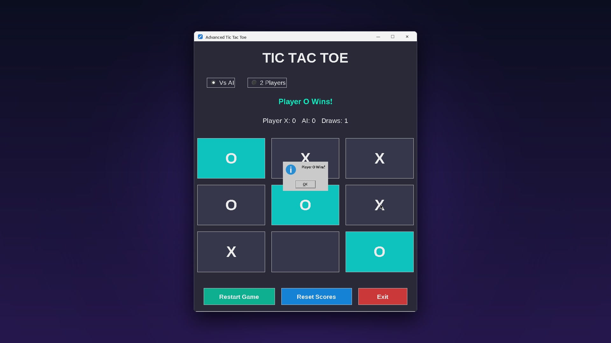
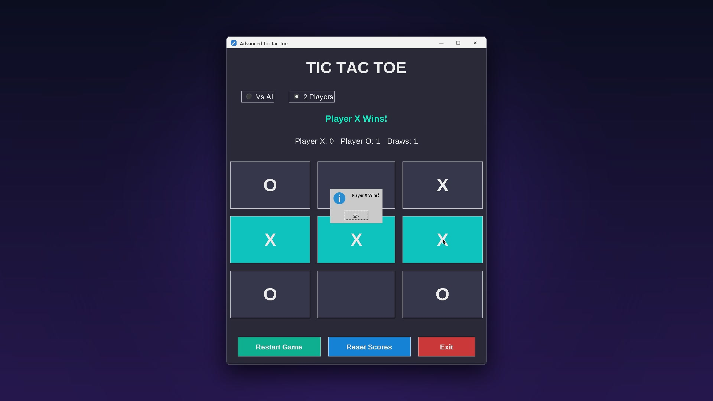

# ❌⭕ Advanced Tic Tac Toe

A clean, dark-themed **Tic Tac Toe** desktop game built with **Python and Tkinter**, featuring an **unbeatable AI powered by the Minimax algorithm**, a local 2-player mode and a live scoreboard.


<p align="center">
  
</p>

---

## ✨ Features

- **Vs AI mode:** the computer plays **O** using a full **Minimax** search, so it never loses (the best you can do is a draw!)
- **2 Players mode:** two people take turns on the same computer
- **Live scoreboard:** tracks Player X wins, AI / Player O wins and draws
- **Winning line highlight:** the three winning cells light up
- **Status bar:** shows whose turn it is and the result
- **Restart Game / Reset Scores / Exit** buttons
- **Responsive layout:** the board grows with the window
- **Optional sound effects:** with `pygame` installed, add your own `click.wav` and `win.wav` to `assets/` and it plays them (the game works fine without them)

---

## 📸 Screenshots

| New game | Draw against the Minimax AI |
| :---: | :---: |
|  |  |
| **The AI punishes a mistake** | **2-player mode: X wins** |
|  |  |

---

## 🚀 Getting Started

**Requirements:** Python 3.8+ with Tkinter (included with the standard Python installer on Windows and macOS).

```bash
# 1. Download or clone this repository, then open the project folder
cd tic-tac-toe

# 2. (Optional) enable sound effects
pip install pygame

# 3. Run the game
python "Tic Tac Toe Game - Source Code.py"
```

> On Linux, install Tkinter first if needed: `sudo apt install python3-tk`

---

## 🎮 How to Play

1. Pick a mode at the top: **Vs AI** or **2 Players**.
2. Player **X** always starts. Click any empty cell to place your mark.
3. Get **three in a row** (horizontal, vertical or diagonal) to win.
4. Use **Restart Game** for a new round, or **Reset Scores** to clear the scoreboard.

---

## 🧠 How the AI Works

The AI uses the **Minimax algorithm**: for every possible move it plays out all remaining moves for both players and scores the outcomes (+1 AI win, −1 player win, 0 draw). It then chooses the move with the best guaranteed result, which makes it impossible to beat.

```python
def minimax(self, board, depth, is_maximizing):
    if self.check_winner_on_board(board, "O"): return 1
    if self.check_winner_on_board(board, "X"): return -1
    if "" not in board: return 0
    ...
```

---

## 🛠️ Tech Stack

- **Python 3**
- **Tkinter:** GUI, grid layout and message boxes
- **pygame** (optional): sound effects

---

## 📂 Project Structure

```
Tic Tac Toe Game/
├── Tic Tac Toe Game - Source Code.py   # the game (≈520 lines)
└── assets/                             # README screenshots / GIF (+ optional click.wav, win.wav)
```

---

## 🔮 Ideas for Future Improvements

- Difficulty levels (e.g. an AI that sometimes makes mistakes)
- Alpha-beta pruning and larger boards (4×4, 5×5)
- Persistent score history
- Online multiplayer

---

## 👤 Author

**Somya Ranjan Sahoo** · [GitHub](https://github.com/somyaranjansahoo6422) · [Portfolio](https://somyaranjansahoo6422.github.io/projects/smaller-builds/)

If you like this project, consider giving it a ⭐!
